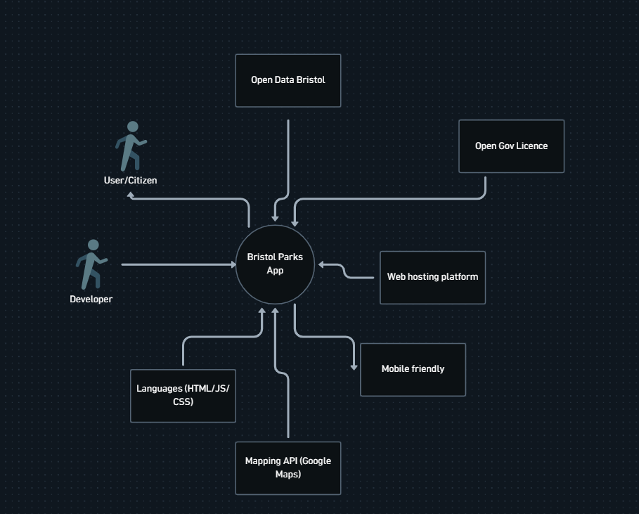

# Project Proposal

## Business Case "ParkFinder Bristol"
* The business case will outline the scope and purpose for building this web application. It is designed to help residents and visitors discover local parks and green spaces around Bristol. 
* By utilizing the parks and green spaces data set provided by Open Data Bristol, the app will produce a centralized, filterable and user-friendly platform directed to user needs, rather than using general mapping tools or using council websites. 

### Problem statement
With existing tools and applications, users can face difficulty when trying to use them: 
* The main aim is to help people identify parks and green spaces around Bristol 
* People may struggle to locate nearby park and green spaces, especially if they are new or unfamiliar to the area 
* Existing tools can lack detailed information or data about certain green spaces. My application aims to bridge that gap by providing information about specfic user needs, such as:  
  * Parks for accessibility 
  * Pet friendly areas 
  * Sport areas & outdoor gyms
  * Recreational & play areas. 

### Business benefits
The application can provide direct value to the user and social value to Bristol community: 

* Helps people find parks and green spaces easily 
* Helps users find exactly what they are looking for quickly (saves time, prevents frustration) 
* Encourages people to get outside, be active and exercise 
* Can boost community engagement (may bring awareness to lesser known green space areas) 
* Creates an opportunity to provide user-sourced data (e.g. park ratings, live updates on facilities, comments)  

### Options Considered
* Google Maps/Apple Maps
  * **Pro:** Good for general navigation  
  * **Con:** Can lack detailed information about green spaces, cannot easily filter out areas in Bristol (e.g Parks with disabled parking) 
* Bristol City Council website 
 * **Pro:** Contains accurate and authoritative information about parks  
 * **Con:** Isn't user friendly, difficult to navigate on mobile, and lacks map and routing based features 

### Expected Risks
* Competing with other applications (market competition) 

  * This can be resolved by offering local and highly specific filters (e.g children swings) that generic maps or apps do not support 

* Relies on the Bristol Open data  

  * The app could implement an API which auto-syncs with the Bristol open data updates 

* Users can also add their own information (e.g suggest an edit) 

  * Users may not appeal to it yet (may struggle to get users on it) 
 
## Project Scope
1. Data integration: Fully integrate Open Data Bristol into the application through the API 

2. Search & filter engine: Ability to search, filter by distance, facilities, accecibility, ect.  

3. Map interface: Be able to show parks/green spaces on a dynamic map or list, sorted by location 

4. Detailed park profiles: Be able to show individual pages displaying park names, description, facility icons, images, ratings etc.. 

