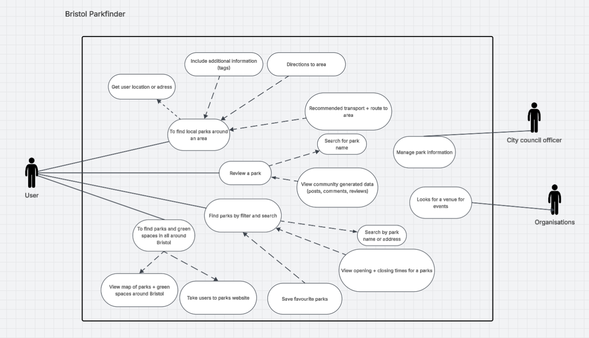

# Requirements

## User Needs

### User stories
* as a citizen, I want to search for parks so that I can go to a specific park
* as a citizen, I want to filter parks by distance so that I know which parks are walking distance
* as a citizen, I want to use a map to so that I can go to a park close to me
* as a citizen, I want to find a park with disability options so that I can go to a park with mobility support
* as a citizen, I want to find a park with sporting equipment so that I can exercise
* as a citizen, I want to find a park with apparatus so that my children can go outside
* as a citizen, I want to look at park opening times so that I can plan my trip
* as a citizen, I want to look at photos of a park so I know which park I can go to

* as a city council worker, I want to use manage park information so that citizens can be updated with new information
* as a organisation, I want to see what parks are available so that I can use it as a venue for my event

### Actors
* Citizen  (local residents, visitor/tourists, parents, pet owners, athletes)
* City council
* Organisation

### Use Cases
TODO: Describe each use case (at least one per team member).
    Give each use case a unique ID, e.g. UC1, UC2, ...
    Summarise these using the use-case template below.

| TODO: USE-CASE ID e.g. UC1, UC2, ... | TODO: USE-CASE NAME | 
| -------------------------------------- | ------------------- |
| **Description** | TODO: Goal to be achieved by use case and sources for requirement |
| **Actors** | TODO: List of actors involved in use case |
| **Assumptions** | TODO: Pre/post-conditions if any</td></tr>
| **Steps** | TODO: Interactions between actors and system necessary to achieve goal |
| **Variations** | TODO: OPTIONAL - Any variations in the steps of a use case |
| **Non-functional** | TODO: OPTIONAL - List of non-functional requirements that the use case must meet. |
| **Issues** | TODO: OPTIONAL - List of issues that remain to be resolved |

TODO: Your Use-Case diagram should include all use-cases.

## Software Requirements Specification
### Functional requirements
TODO: create a list of functional requirements. 
    e.g. "The system shall ..."
    Give each functional requirement a unique ID. e.g. FR1, FR2, ...
    Indicate which UC the requirement comes from.

### Non-Functional Requirements
TODO: Consider one or more [quality attributes](https://en.wikipedia.org/wiki/ISO/IEC_9126) to suggest a small number of non-functional requirements.
Give each non-functional requirement a unique ID. e.g. NFR1, NFR2, ...

Indicate which UC the requirement comes from.
