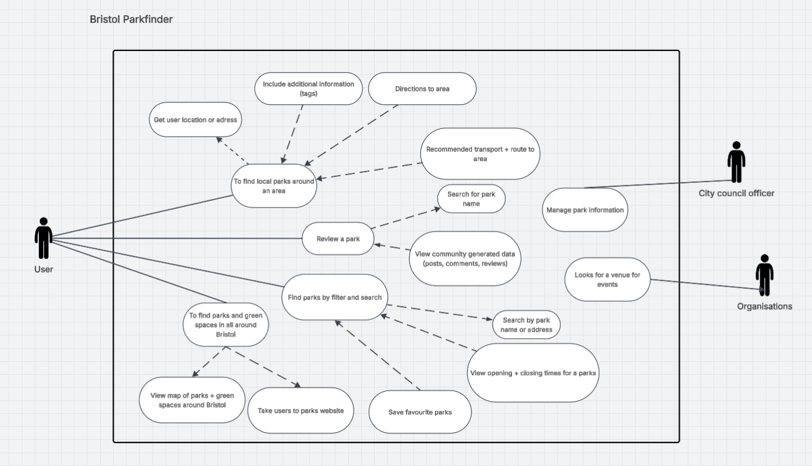

# Requirements

## User Needs

### User stories
* as a citizen, I want to search for parks so that I can go to a specific park
* as a citizen, I want to filter parks by distance so that I know which parks are walking distance
* as a citizen, I want to use a map to so that I can go to a park close to me
* as a citizen, I want to find a park with disability options so that I can go to a park with mobility support
* as a citizen, I want to find a park with sporting equipment so that I can exercise
* as a citizen, I want to find a park with apparatus so that my children can go outside
* as a citizen, I want to look at park opening times so that I can plan my trip
* as a citizen, I want to look at photos of a park so I know which park I can go to

* as a city council worker, I want to use manage park information so that citizens can be updated with new information
* as an organisation, I want to see what parks are available so that I can use it as a venue for my event

### Actors
* Citizen  (local residents, visitor/tourists, parents, pet owners, sports people)
* City council
* Organisations

### Use Cases

| UC1 | Search for nearby parks around an area| 
| -------------------------------------- | ------------------- |
| **Description** | As a citizen, I want to find nearby parks by a given postcode/address |
| **Actors** | Citizen |
| **Assumptions** | The citizen knows their location
| **Steps** | 1. Opt to search for nearby green space 2. Request the user for permission to use their location, or ask them to input an address manually 3. Show parks, sorted from lowest to highest distance, based on the users address/location|
| **Variations** |1. Shows a map instead of a list 2. Shows time to get to destination with recommended modes of transport  3. Be able to recommend areas beyond than the users address (e.g expand to more areas)
| **Non-functional** | 1. Should be able to get the users location 2. Able to work on mobile devices 3. Suggest user to expand their radius or choose a different location 3. It should load results fairly quickly |
| **Issues** |1. The system is unable to locate parks nearby 2. Will it work if the user denies location permission |

| UC2 | View a map of nearby parks| 
| -------------------------------------- | ------------------- |
| **Description** | As a citizen, I want to find nearby parks by a given postcode/address |
| **Actors** | Citizen |
| **Assumptions** | The system has access to park location data 
| **Steps** | 1. The user opens the map 2. System displays map 3. The user is able to interact with the map (zoom in, zoom out) 4. The system is able to display park information |
| **Variations** |1. User can zoom in and out 2. The map should be easy to navigate
| **Non-functional** | 1. Map should load quickly and smoothly 2. Map markers should be visible 3. The map should provide accessible alternatives to visual maps |

| UC3 | Filter parks by facilities| 
| -------------------------------------- | ------------------- |
| **Description** | Find parks that have specifc capabilities or features |
| **Actors** | Citizen |
| **Assumptions** | There is information about the park
| **Steps** | 1. The user opens the filter menu 2. System displays avaiable filters 3. User selects desired facilities 4. System applies the filters 5. System returns results matching the facilities |
| **Variations** |1. User can select multiple facilities at once. 2. User can remove filters
| **Non-functional** | 1. Results accurately match filters 2. Users can select multiple filters |

| UC4 | View park information| 
| -------------------------------------- | ------------------- |
| **Description** | Learn more about a selected park |
| **Actors** | Citizen |
| **Assumptions** | User has selected a park
| **Steps** | 1. User selects a park 2. The system returns the park's name and description 3. The system displays photos, opening hours and facilities 4. The user can review the information|
| **Variations** |1. User wants additional accessibility information
| **Non-functional** | 1. Information should be easy to read and understand 2. Photos should load 3. Information should disability-friendly 4. Park information should be accurate |

## Software Requirements Specification
### Functional requirements
* FR1: Search for nearby parks (UC1)
  * FR1.1: The system **must** be able to locate parks and green spaces, provided by given distance radius from the user's input
  * FR1.2: The system **must** return and display parks and green spaces within a specified radius of the user’s selected location, from the Parks & Green spaces database
  * FR1.3: The system **should** be able to get the users geo-location (if the user allows it), from the device's location permissions
  * FR1.4  The system **can** track the users real time, dynamic location if they are using it with a mobile device
* FR2: View a map of nearby parks (UC2)
  * FR2.1: The system **must** be able to display a graphical map based from the parks & green spaces database
  * FR2.2: The system **must** be able to allow the user to interact with the map (zoom in, zoom out) via the user's input
  * FR2.3: The system **must** be able to provide more information & details about a chosen site from the user
  * FR2.4: The system **must** be able to display graphical map markers for parks & green spaces
* FR3: Filter maps by facilities (UC3)
  * FR3.1: The system **must** be able to accept user facilities filters
  * FR3.2: The system **must** be able to process user facility search, and return matching parks & green spaces
  * FR3.3: The system **can** suggest similar parks & green spaces to the filters given by the user
* FR4: View park information (UC4)
  * FR4.1: The system **must** allow a user to select and view more information about a park/green space
  * FR4.2: The system **must** provide information about the user's chosen park/green space (such as location, opening times, park's website, facilities, etc.)
  * FR4.3: The system **can** allow users to provide user generated data (e.g. photos, reviews, comments, etc.)
  * FR4.4: The system **can** provide the option to "take me there" by providing directions or transportation routes to the park/green space

### Non-Functional Requirements
* NFR1: The system should be able to retrieve the users location.
  * **Quality**: Accuracy  
  * **Quality Attribute**: How accurate is the system able to get the user's exact location?
  * **Quality Criteria**: We compare the user's actual location and the location the system returns. If the distance is within a mile, we can say that the ability of retrieving the location is accurate. 
* NFR2: The system should suggest the user to expand their radius or choose a different location.
  * **Quality**: Reliability  
  * **Quality Attribute**: This is to ensure that if there are no nearby results (parks and green spaces outside the user's location) and does not error. 
  * **Quality Criteria**: We test this by intentionally inputting an location where there are no nearby parks and green spaces. We test if the system breaks or will actually return a warning message or suggestion to search for a different location.
* NFR3: The system should load park results fairly quickly.
  * **Quality**: Functionality  
  * **Quality Attribute**: The system should be able to yield results in <5 seconds.
  * **Quality Criteria**: We test the system on a slow network. If it cannot fetch results in time, it should show a warning message unable to fetch results.
* NFR4: The system should be able to make map markers or icons visible on the graphical map.
  * **Quality**: Accessibility  
  * **Quality Attribute**: It should have accessibility options so that everyone is able to use it. Map markers or icons should be clear and obvious.  
  * **Quality Criteria**: We test the system on devices that can support accessibility options.
* NFR5: The system should should provide accessible alternatives to visual maps.
  * **Quality**: Accessibility
  * **Quality Attribute**: The user can opt in for a list, grid, graph display if they prefer.
  * **Quality Criteria**: We test these options. 
* NFR6: The system should return results accurately match chosen filters.
  * **Quality**: Reliability
  * **Quality Attribute**: The system should return park and green spaces results, that match chosen filters, distance, and location.
  * **Quality Criteria**: We test the system with various searches and filters.
* NFR7: The system should be able to return results from matching filters, can select or remove multiple filters.
  * **Quality**: Fault-tolernce
  * **Quality Attribute**: The system should return park and green spaces results, that match chosen filters, distance, and location. The system should be able to work with filters and results dynamically, the system should not produce errors when this happens.
  * **Quality Criteria**: We test the system with various searches and filters.
* NFR8: The system should provide information should be easy to read and understand.
*   * **Quality**: Accessibility
*   * **Quality Attribute**: Text and images should be accessibility friendly
    * **Quality Criteria**: We test the system on devices that can support accessibility options and see if it works.
* NFR9: Park information should be accurate and updated.
    * **Quality**: Accuracy
    * **Quality Attribute**: The system relies on the Open Data Bristol database
    * **Quality Criteria**: We compare the information found on the system and the information avaliable on the Open Data Bristol, and see if they are matching.
